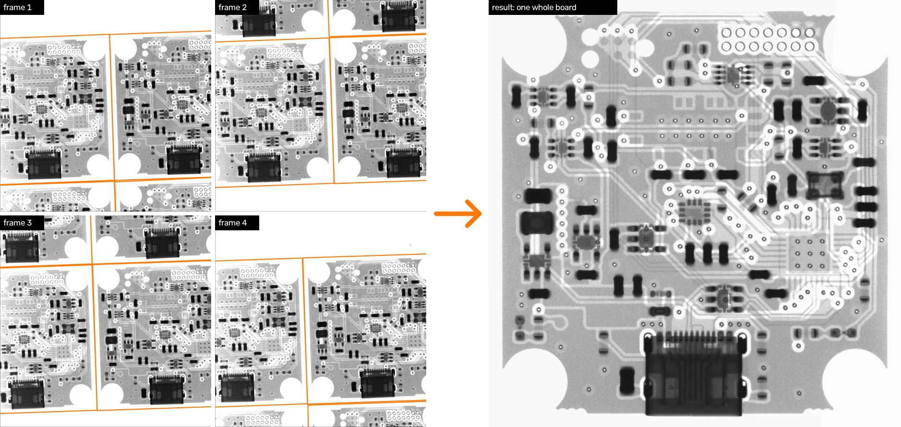
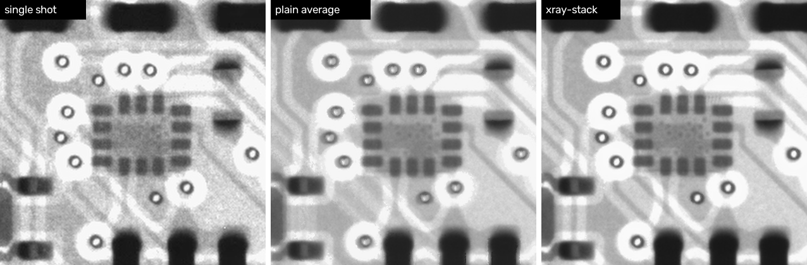
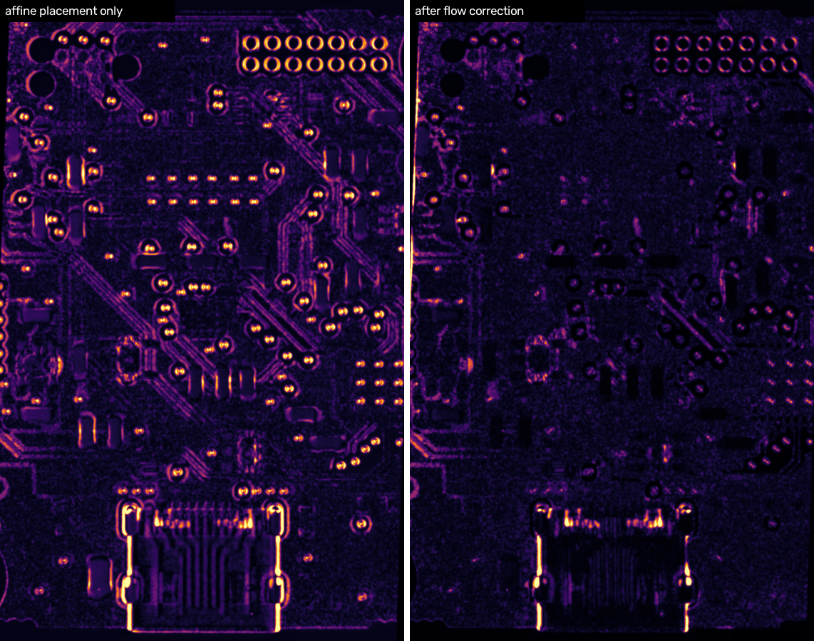
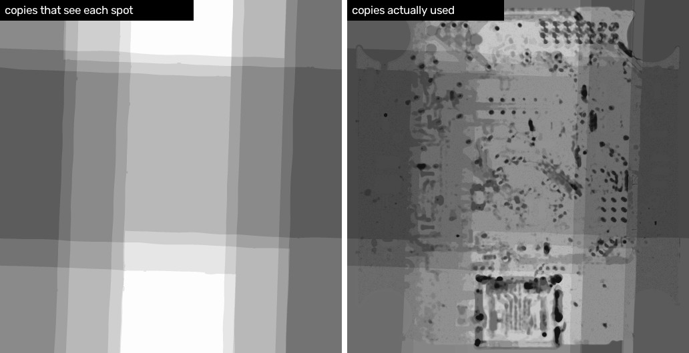
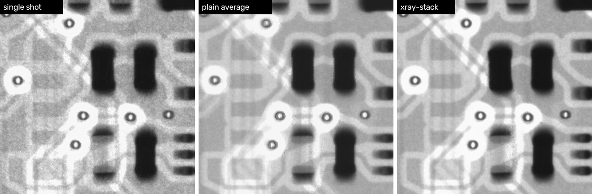
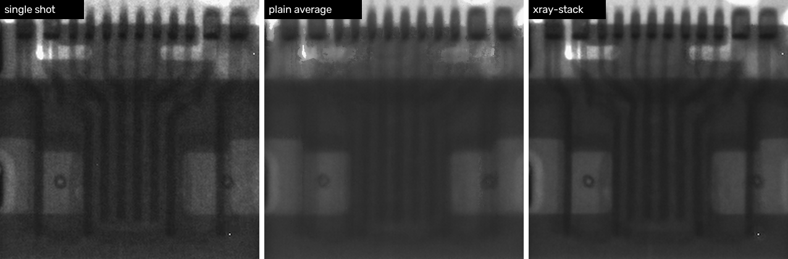

# xray-stack

Four X-ray shots of a PCB panel, none of which shows a complete board, combined into one clean image of
the whole board.



The panel is a grid of identical boards, and each 1537 px shot catches about one and a half of them
across. Every board is cut off by a frame edge somewhere, and every shot is grainy. Between them, though,
the four shots contain 14 full or partial copies of the same board (outlined above), which is enough to
rebuild one complete board with less than half the noise of a single shot and the same sharpness.

| | single shot | plain average | xray-stack |
|---|---|---|---|
| noise on bare board (grey levels) | 6.8 | 2.6 | 3.1 |
| whole board visible | no | yes | yes |
| sharpness | sharp | blurred | sharp |

The full-size result is [`docs/fused.png`](docs/fused.png) (2050 × 2120).



## Running it

```bash
python -m venv .venv && .venv/bin/pip install -r requirements.txt
```

```bash
.venv/bin/python xray_stack.py samples/1.webp samples/2.webp samples/3.webp samples/4.webp -o output
```

This takes a few minutes and writes `output/fused.png` along with the diagnostic images used on this
page.

## How it works

Aligning identical images and averaging them sounds like a few lines of OpenCV. Done that way, the result
is blurrier than any single shot (the middle panel above). Most of the tool exists to deal with the
reasons for that.

### Finding the copies

Feature matching normally assumes that each feature appears once. Here every feature appears once per
board, so two to four times per shot. If you match a reference board against a shot, each keypoint has
several equally good candidates, and Lowe's ratio test, which rejects a match unless it is clearly better
than the runner-up, rejects nearly all of them.

The fix is to match in the other direction. The shot's keypoints are the queries, and they are matched
against a reference that contains exactly one board. Each query then has one right answer and the ratio
test works as intended.

The matches from one shot are a mixture of several transforms, one per copy. RANSAC is run repeatedly to
separate them: it fits the largest consensus set (a similarity transform with 2 px tolerance), those
inliers are removed, and it fits again, until fewer than 20 inliers remain.

There is also no complete board to use as the reference, since no shot contains one. The reference starts
as a rough hand-drawn box around one cut-off board, which is the only manual input. After each pass, the
copies found so far are averaged into a mosaic, and the mosaic becomes the next reference. It covers the
whole board and is less noisy, so it finds copies the seed could not:

| pass | reference | copies found |
|---|---|---|
| 0 | seed box (one cut-off board) | 11 |
| 1 | mosaic | 13 |
| 2 | mosaic | 14 |

The copies that turn up late are slivers at the top and bottom of a frame, placed from as few as 23
matches. Full copies are placed from 800 to 1100 matches with a median residual of about 0.7 px.

### Why an affine fit is not enough

A residual of 0.7 px over a thousand matches is larger than it should be for a flat rigid object, and the
first version of the registration showed why. After a copy's inliers were removed, RANSAC kept finding the
same board again: a second consensus set of 30 to 120 matches, offset from the first by a few pixels and
with a scale that differed by up to 0.5 %. My reading is that it was fitting one layer of the board and then another.
(The tool now discards any fit within 40 px of a copy it already has.)

The cause is the geometry of the machine. The source is close to a point, so the image is a perspective
shadow, and every shot shows all layers of the board on top of each other. A feature at height *z* above
the bottom of the board, at distance *r* from the beam axis, lands further out than it would at *z* = 0 by
about

```
shift ≈ r · z / d        (d = distance from source to board)
```

Bottom copper, top copper and component bodies sit at different heights, so they slide against each other
as the board moves across the frame. Two copies a board-width apart are therefore not related by any
affine transform. The fit splits the difference between the layers, and an average built on that fit
doubles every edge.

The size of the correction that the next step ends up applying confirms this. It depends on how far a copy
sits from the reference copy's position in the frame:

| copy's distance from the reference's frame position | median shift | 95th percentile |
|---|---|---|
| 58 to 180 px (3 copies) | 0.9 to 1.0 px | 3.2 to 4.0 px |
| 865 to 1070 px (5 copies) | 1.8 to 2.7 px | 4.3 to 4.8 px |

Part of the roughly 1 px seen for nearby copies is probably the noise floor of the flow estimate. A shift
of 2 to 4 px between copies 1000 px apart corresponds to a height difference of 0.2 to 0.4 % of the source
distance, which is the right order of magnitude for a board a millimetre or two thick a few hundred
millimetres from the source. I do not know the actual geometry of the machine.

### Correcting parallax with optical flow

Each copy gets a per-pixel correction on top of its affine placement. DIS optical flow is computed from
the current reference to the affine-placed copy. Raw flow on noisy X-rays is jittery, so it is smoothed by
normalised convolution (σ = 5 output px, weighted by where both images have data), and shifts above 6 px
are treated as failures and zeroed. Where a copy extends beyond the reference, the flow is extrapolated
outward with much wider kernels so that there is no seam at the edge of the overlap.

Two details matter for sharpness:

- The flow is added to the canvas coordinates before they pass through the inverse affine. Placement,
  deskew and parallax correction are then applied in one Lanczos resample of the original shot. Warping an
  already-warped image would cost the sharpness this step is trying to keep.
- The reference starts as one real copy and is replaced by the average of all corrected copies after each
  of three rounds. In the first round it covers only part of the board, and from the second it covers all
  of it.

The picture below shows the difference between one copy and the final image, before and after this
correction. The copy sat about 870 px from the reference in its frame. Misaligned edges show as bright
lines on the left and are mostly gone on the right.



### Parts with depth

Optical flow is a 2-D warp, and it assumes that each pixel shows one thing. That does not hold inside a
part like the USB-C receptacle, where pins at different depths overlap and the overlap changes with the
viewing angle. No warp turns one view into the other, and averaging them gives a smear, which is what
remains bright in the right-hand panel above.

The final average is therefore weighted. For each copy *k* the tool computes `D_k`, the local mean
(σ = 3 px) of the squared difference from one real copy, and compares it with what noise alone would
produce. X-ray noise varies with brightness, so the expected value is measured from the data in 16
grey-level bins. The mismatch that a 0.4 px placement error would cause at a sharp edge is subtracted
first, so that edges are not penalised. The weight is

```
w_k = exp(-1.5 · max(0, (D_k - edge) / noise - 2))
```

followed by per-pixel MAD outlier rejection. Where every other copy has been weighted down, the reference
copy is used on its own.

On flat board this keeps nearly everything: 7 copies cover the median pixel and about 6 are effectively
used. Inside the connector only the copies that saw it from nearly the same position survive.



### Brightness and tilt

Two smaller corrections run between registration and the flow step.

**Flat field.** The left edge of the detector reads brighter, so a copy near that edge is lighter than the
same board in the middle of the frame, and averaging them leaves a brightness step where the set of
contributing copies changes. There are no calibration frames, but the same board feature is seen at many
detector positions, which is enough. In the log domain,

```
log I_k(x) = b(x) + f(p_k(x)) + g_shot
```

where `b` is the board, `f` is a degree-3 polynomial over detector position shared by all shots, and `g`
is a per-shot exposure. Subtracting the mean over copies at each board position removes `b` exactly and
leaves a linear least-squares problem. This reduces the brightness disagreement between copies from
5.08 % to 2.25 % rms, and the step disappears.

**Deskew.** PCB artwork runs at 0, 45 and 90 degrees. The tool detects line segments with LSD, keeps those
longer than 30 px, folds their angles modulo 45 degrees so that all three directions vote for the same
number, and takes the length-weighted mean. On the sample, 237 segments give a tilt of −1.87 degrees. The
rotation is folded into each copy's affine, so it adds no resampling.

## Results



The connector is the weak spot. It comes out cleaner than a single copy but softer than the flat board
around it, because few copies agree there:



## Using it on other boards

The tool applies to any set of shots in which the same design appears several times: a panel, one board
shot at several positions, or a tray of identical parts. It has only been run on the sample panel, so
expect to adjust settings.

```bash
.venv/bin/python xray_stack.py shots/*.png --seed-image 0 --seed-box 120 80 1100 1050 --canvas 1200 1200 --crop 40 40 1160 1160
```

- `--seed-image` and `--seed-box` give a rough box (`x0 y0 x1 y1`) around one board in one shot. The box
  does not need to be tight, and the board does not need to be complete.
- `--canvas` is the working area in source pixels, slightly larger than one board.
- `--crop` is the part of the canvas to keep. Run once, look at `fused_canvas.png`, then set it.
- `--deskew auto|off|DEG`, `--scale` (default 2), `--margins` (frame border to ignore) and
  `--no-flatfield` cover the rest.

After a run, check `found_*.png` to confirm that every board in every shot was outlined, and
`coverage.png` to see how many copies cover each part of the board.

## Limits

- Parts with depth improve less than flat areas, as described above. Recovering them properly needs
  tomography.
- The reference copy is trusted. Where it is the only copy used, its defects come through, and a few stuck
  pixels inside the connector are visible for this reason.
- The 2× output grid keeps a little more detail than the source grid would, because the copies fall at
  different sub-pixel offsets. It is not a 2× gain in resolution, and no sharpening is applied.
- The sample shots are 8-bit lossy WebP. Raw detector output should do better, especially in dark areas.
- The flat-field model assumes one brightness pattern shared by all shots.
- The seed box is drawn by hand, once per panel.

## License

MIT. See [LICENSE](LICENSE).
